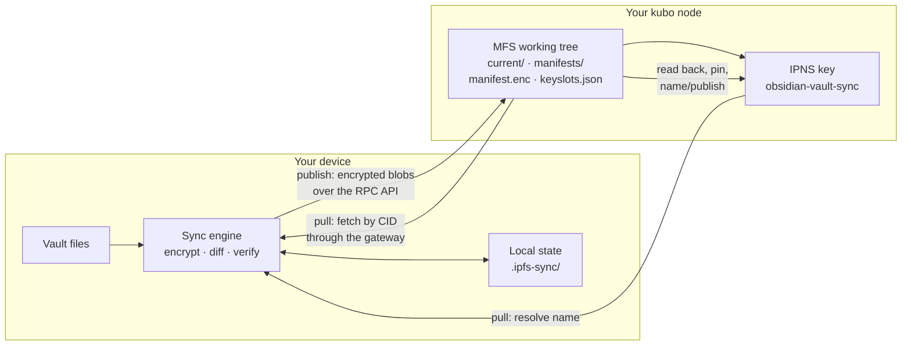

# How it works

<!-- source: README.md L45-77; DESIGN.md §8.3, §8.4, §8.10 -->

IPFS Sync is a snapshot synchronizer. Each publish encrypts the vault's changed
files, stages them in a working tree on your kubo node, and moves one mutable
pointer to the new snapshot. Each pull resolves that pointer, authenticates the
snapshot's manifest and fetches only the files whose content hash differs.

## The node and the working tree

<!-- source: README.md L47-62; DESIGN.md §8.3 (MFS layout row) -->

The server side is a stock **kubo** node you run or trust. The tool talks to it
over the kubo RPC API (writes) and the gateway (reads); there is no local IPFS
daemon on your device. Every vault lives in an **MFS** (Mutable File System)
root strictly below `/obsidian-vault-sync`, one root per vault. MFS is the
staging area: blobs land there first, and only a verified snapshot is pinned
and published.

The root holds exactly four entries:

- `current/` — the encrypted files, each under an opaque 52-character name
  (an HMAC of its path) inside two-character prefix folders;
- `manifests/` — one encrypted history copy of the manifest per publish, named
  `<16-digit sequence>-<rootCID>.enc` (a development build wrote
  `<rootCID>.enc`, which still reads);
- `manifest.enc` — the encrypted manifest of the current snapshot;
- `keyslots.json` — the public key-slot file (see [Security](security.md)).

## The mutable pointer

<!-- source: README.md L57-64 -->

An **IPNS key** on your node (default name `obsidian-vault-sync`) is the only
mutable part. Each publish points it at the CID of the MFS root; `publish`
creates the key if absent and records its ID in the config file (`ownedKeys`).
Readers resolve the name to the current snapshot CID. DNSLink can replace the
name with a human-readable one on a domain you control — same content, one DNS
record.

## Delta publish

<!-- source: README.md L738-779; DESIGN.md §8.4 -->

A publish compares the vault against its own record on plaintext sha256 and
size; a file whose size and modification time match the record is not read
again. Only changed files are encrypted and uploaded — a changed file is
re-encrypted and uploaded whole, and a rename is a delete plus a new upload,
because the node name is bound into the encryption. The run then writes
`manifest.enc` and its history copy, reads the snapshot back through its
immutable `/ipfs/<cid>/` path, and only then pins it and publishes the IPNS
record. Any failure before the IPNS record leaves the previous pointer
unchanged; a run with no changes writes nothing. Every file a publish skips
(for example one deleted or changed mid-read) is named with its reason, so the
published set is exact.

## Pull and the conflict policy

<!-- source: README.md L66-77, L236-247 -->

Pull never deletes and never loses data. Each file is compared on plaintext
sha256 three ways: this device's file, the baseline of the last pull or
publish, and the node's copy.

- A file this device did not edit is replaced by the node's version.
- A file only this device edited stays.
- Where both changed (or there is no baseline), the node's version takes the
  path and the local content is preserved as `name (ipfs conflict
  YYYY-MM-DD).ext` — the extension is kept so the copy opens in the same app.
- Remote deletions are reported, not applied: a file deleted on the publishing
  side stays on the receiving side.

A pull fetches each file from the immutable tree the authenticated manifest
names — never the mutable `current/` — decrypts it into `.ipfs-sync/tmp/` and
renames it into place only when its size and sha256 equal the manifest entry.
The CLI and the plugin run the same pull engine. Pull also refuses manifest
paths it must not write (absolute paths, `..` segments, anything inside
`.ipfs-sync/` or `.obsidian/`, excluded paths, and names another platform can
write that this one cannot take safely); a refused path is skipped and the rest
of the pull continues. True merging arrives with the Phase 2 op-log — see the
[roadmap](roadmap.md).

## The publish/pull flow

## What a second device does

<!-- source: README.md L290-292 -->

A second device uses the same MFS root and publication key name, adopts the
owned key (its ID in `ownedKeys`, or `--owned-key <id>` for one CLI run), and
pulls before its first publish. Two devices take turns; they do not publish at
the same time. Concurrent publishes are narrowed by a name re-check, not
prevented — kubo has no compare-and-swap (see
[Limitations](limitations.md)).
